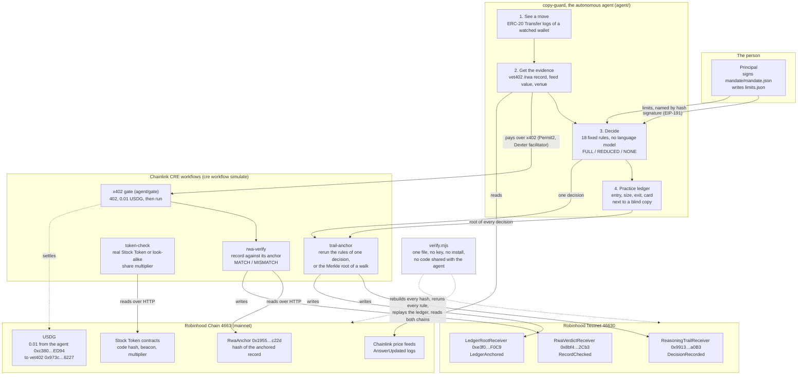

# Architecture

One page: who pays whom, where each check happens, and what stays on which chain.

## Who pays whom

| Payment | From | To | How | Status |
|---|---|---|---|---|
| 0.01 USDG for the wallet's record | the agent's wallet `0xc380…ED94` | vet402's wallet `0x973c…6227` | x402 v2, `exact`, Permit2, settled by the Dexter facilitator, which pays the gas | settled once, 2026-10-08, tx `0x65c314bd…87af61`. My own test: both wallets are mine |
| 0.01 USDG for one run of `rwa-verify` | the agent's wallet | the same vet402 wallet | the same terms, asked for by the gate in front of the workflow | dry run only: the agent read the 402 and built the payment without signing |
| testnet gas for the CRE writes | a testnet-only key | Robinhood Testnet | `cre workflow simulate --broadcast` | no real value |

The agent can pay one address. `pickAccept` refuses any other payee, token, chain or price before a signature exists, and the Permit2 witness pins the recipient inside the signed message. The cap is 1 USDG in code. The user's `limits.json` can lower it and cannot raise it.

## Where each check happens

| Check | Where | What it refuses |
|---|---|---|
| The record is the one vet402 anchored | CRE `rwa-verify` | one changed character, another contract, operator, wallet or date |
| The token is the issuer's real Stock Token | CRE `token-check`, straight from the chain | a look-alike with a copied ticker or name, without asking vet402 |
| The decision follows from its inputs | the agent, then CRE `trail-anchor`, then `verify.mjs` | a conclusion, a size or a card the rules do not give |
| The person authorized it | rule M1 in every decision | no signature, another signer, other rules, other limits, another payment key, another date |
| The size stays inside the user's limits | rules L1 and L2, and the sizes in `limits.json` | more than the daily limit, more open positions than allowed |
| Nothing was changed afterwards | `verify.mjs` | any file that no longer hashes to what is onchain |

## What stays where

| Where | What | Changeable afterwards |
|---|---|---|
| Robinhood Chain | the anchor of the demo wallet's record, the 0.01 USDG settlement, every move the agent judged, every feed value | no |
| Robinhood Testnet | one `RecordChecked` per CRE verdict, one `DecisionRecorded` per single decision, one `LedgerAnchored` with the Merkle root of a whole walk | no. All three receivers have no owner, no storage and no upgrade path |
| This repo | the records as read, the feed values, one trail per decision, the ledger, the mandate, the limits | yes, and `verify.mjs` then fails at the line that compares the hash |

The testnet receivers trust CRE's simulation forwarder, which accepts reports from anyone. An event there fixes a hash and a time. It does not show that a DON produced it. The content is shown to be right by rerunning it.

## A walk, step by step

1. `bun agent/walk.ts` reads each wallet's record once from vet402's free route and lists the moves the record names as evidence.
2. For each move, in block order, it reads the receipt, the block time, the venue the Stock Token came from and the Chainlink feed's last value at or before that block.
3. The 18 rules give a size. The practice book opens, or does not open, a position. Earlier positions leave when the copied wallet sells, when the feed crosses the stop or the target, or when the time limit passes.
4. Each decision becomes one JSON trail with a card. Its keccak256 is a leaf.
5. The CRE workflow `trail-anchor` recomputes the Merkle root from the leaves and writes it once to `LedgerRootReceiver`.
6. `node scripts/build-page.mjs` puts the ledger into `docs/index.html`.
7. `node verify.mjs` reruns all of it from the saved files and compares with both chains.
